# Cuestiones UT3

## 1. De .cshtml a HTML

Cuando ejecuto `dotnet build -p:EmitCompilerGeneratedFiles=true`, Razor convierte los archivos `.cshtml` en código C# y después se compilan dentro de `NovaHarvest.Web.dll`. Por ejemplo, `Status.cshtml` se convierte en una clase llamada `Pages_Status`. Lo mismo ocurre con `Surplus.cshtml`.

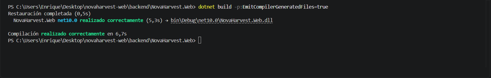

En el código generado aparecen `WriteLiteral`, que escribe el HTML directamente, y `Write`, que muestra el resultado de las expresiones C#.

Por ejemplo, `WriteLiteral("\r\n<h1>Estado del servidor</h1>\r\n\r\n<p>Fecha y hora del servidor: ");` corresponde al HTML del título y del párrafo de `Status.cshtml`. En cambio, `Write(Model.ServerTime.ToString("dd/MM/yyyy HH:mm:ss"))` corresponde a la expresión `@Model.ServerTime.ToString("dd/MM/yyyy HH:mm:ss")` de esa misma página.

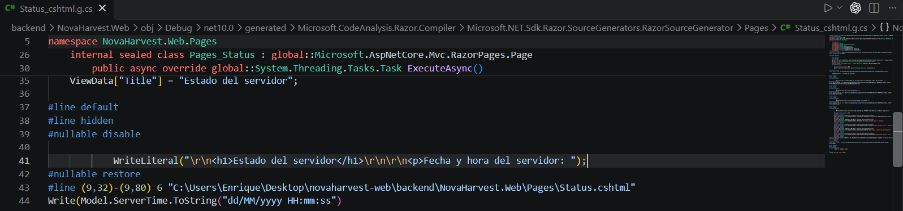

Cuando se solicita `/surplus`, ASP.NET Core utiliza la página compilada junto con `SurplusModel` para generar el HTML que recibe el navegador. Por eso, dentro del contenedor no hacen falta los archivos `.cshtml`, porque ya están compilados en `NovaHarvest.Web.dll`.

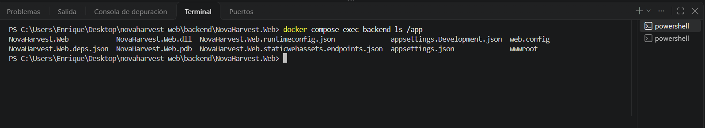

## 2. Tecnologías

En mi página Razor, la línea es: `<p>Precio de excedente: @Model.DiscountedPricePerKg.ToString("C") / kg</p>`.
En PHP se escribiría: `<p>Precio de excedente: <?= ... ?> / kg</p>`.
En ASP clásico sería: `<p>Precio de excedente: <%= ... %> / kg</p>`.
PHP utiliza `<?php ... ?>` para insertar código y `<?= ... ?>` para mostrar un valor.
ASP clásico utiliza `<% ... %>` para insertar código y `<%= ... %>` para mostrar un valor.
En cambio, Razor utiliza `@` para indicar dónde empieza el código y deduce dónde termina.

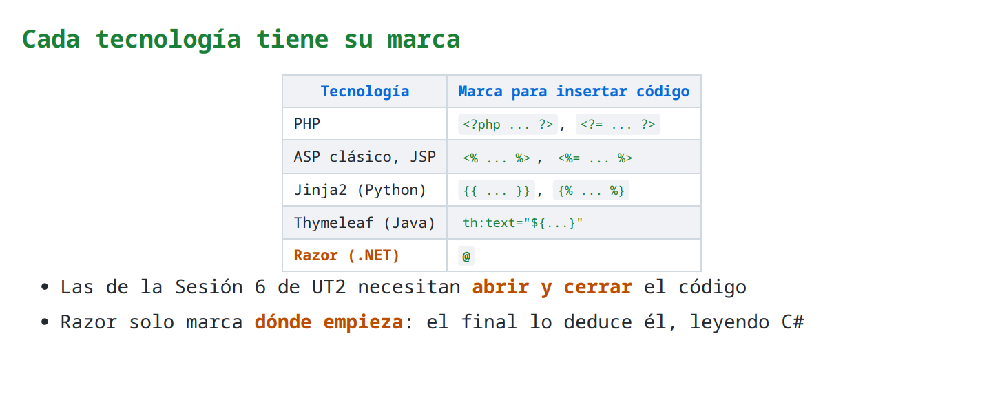

En UT2, mi `Program.cs` tenía tres `MapGet` y cada uno contenía el HTML de una página dentro de una cadena de texto.

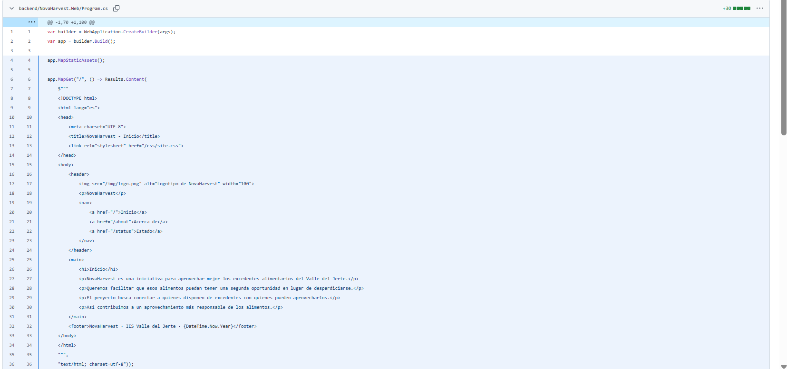

Ahora utilizo `AddRazorPages()` y `MapRazorPages()`, mantengo `MapStaticAssets()` y añado `UseRequestLocalization("es-ES")`, sin utilizar ningún `MapGet`.

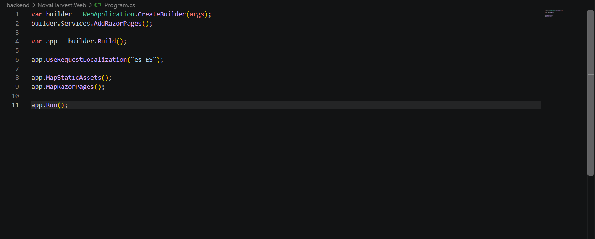

Así, cada página tiene su propio archivo `.cshtml` y puedo compartir la cabecera, el menú y el pie mediante el layout, evitando repetir el mismo HTML.

## 3. Etiquetas de código

En mi proyecto utilizo estos ejemplos de Razor:

| Tipo | Código de mi proyecto | HTML generado |
|---|---|---|
| Expresión implícita | `@Model.Surplus.Product` | `<h2>Cereza Picota</h2>` |
| Expresión explícita | `@(Model.Surplus.Note ?? "Sin observaciones")` | `<p>Nota del productor: &lt;b&gt;Recoger antes de las 14:00&lt;/b&gt;</p>` |
| Bloque `@{ }` | `@{ ViewData["Title"] = "Acerca de"; }` | `<title>NovaHarvest - Acerca de</title>` (a través del layout) |
| `@@` | `@@novaharvest` | `@novaharvest` |
| Comentario Razor | `@* Comentario de la página Acerca de *@` | No genera HTML, porque Razor elimina el comentario. |

El correo `info@novaharvest.es` no necesita `@@` porque la arroba está dentro de una dirección de correo y Razor la reconoce como texto. En cambio, `@novaharvest` empieza con una arroba después de un espacio, por lo que Razor puede interpretarla como código. Por eso utilizo `@@` para mostrarla como texto.

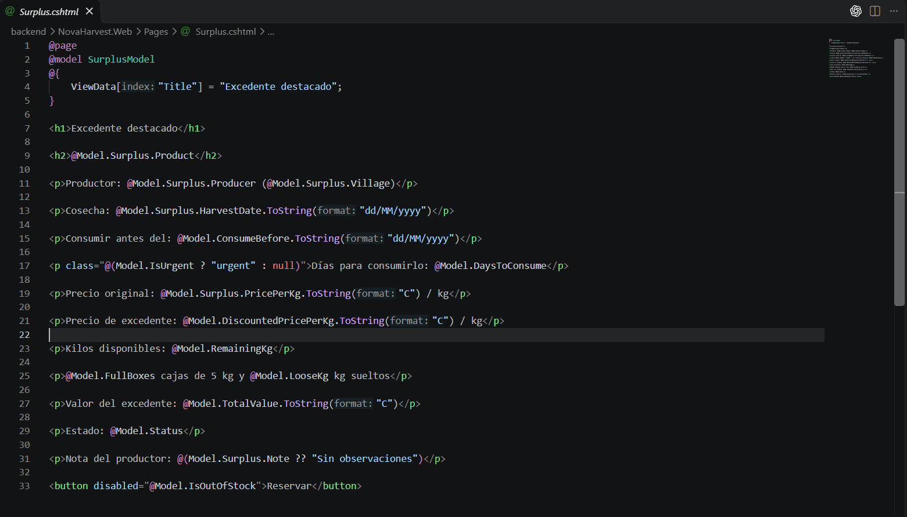

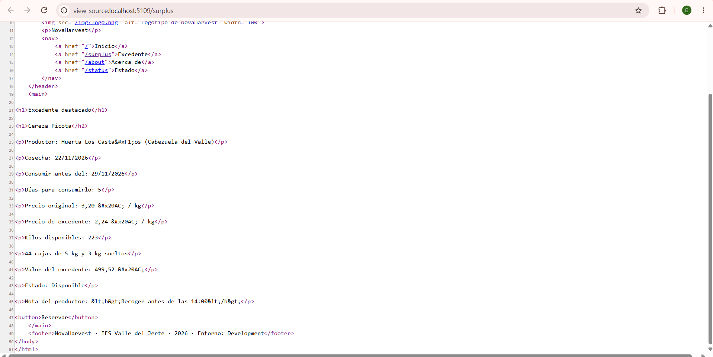

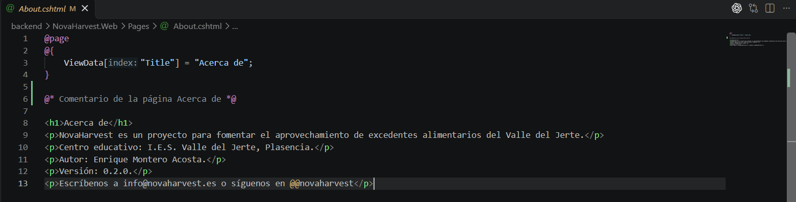

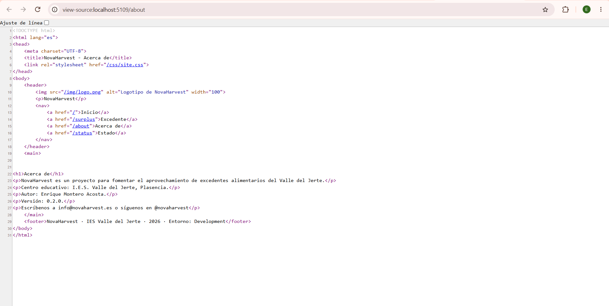

## 4. Sintaxis

En mi proyecto, la línea del precio utiliza `Model.DiscountedPricePerKg`, así que sustituí temporalmente esa expresión por `@Model.SurplusPrize`.
Al ejecutar `dotnet build` apareció el error `CS1061`: `"SurplusModel" no contiene una definición para "SurplusPrize"`.
Esto ocurre porque esa propiedad no existe en mi clase `SurplusModel`, por lo que no puede compilar.

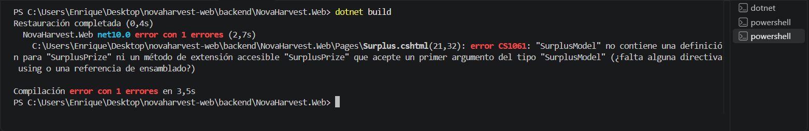

Después añadí `@Model.Surplus.PricePerKg * 0.7m` en una línea de prueba y `dotnet build` terminó correctamente.

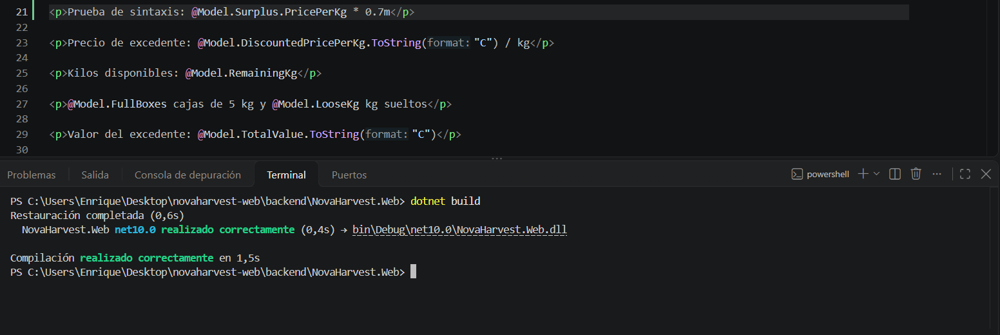

Sin embargo, en la página apareció `3,20 * 0.7m`, porque Razor solo interpreta `@Model.Surplus.PricePerKg` como código y el resto lo muestra como texto.

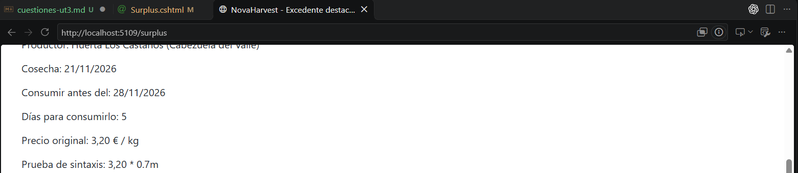

Para que realice la multiplicación hay que escribir `@(Model.Surplus.PricePerKg * 0.7m)`.

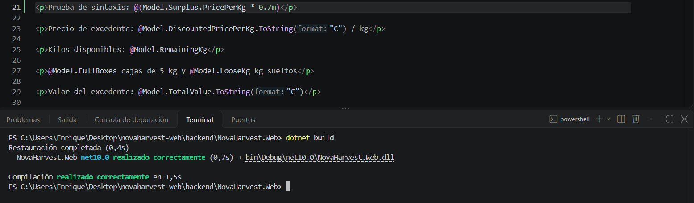

Con esta corrección, el resultado que apareció en la página fue `2,240`.

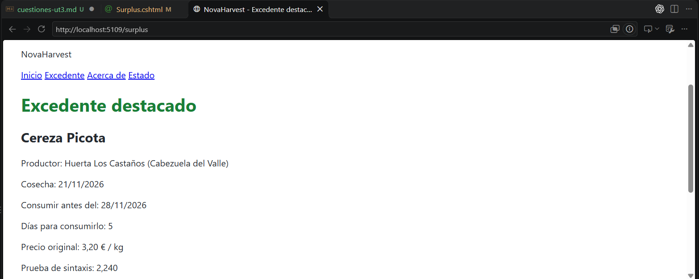

Finalmente, eliminé la línea de prueba y restauré el precio de excedente original.

## 5. Efectos en el documento

En mi página, la nota del productor se ve como texto normal, mostrando las etiquetas `<b>` sin aplicar la negrita.
En el código fuente HTML aparecen como `&lt;b&gt;` y `&lt;/b&gt;`, porque Razor codifica los caracteres especiales para que el navegador no interprete esas etiquetas.

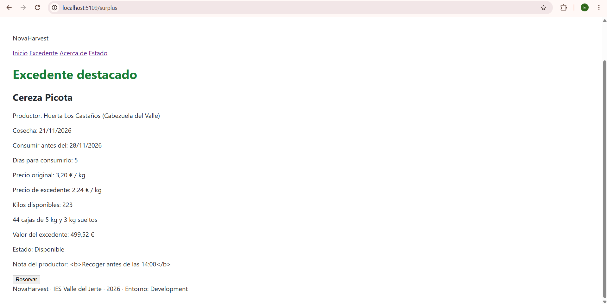
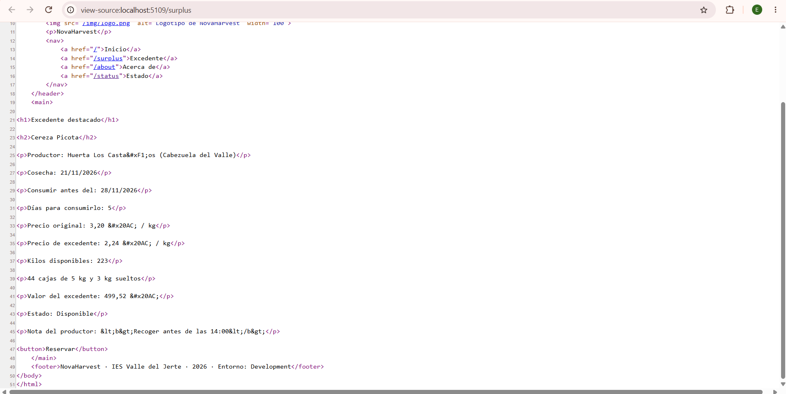

Esto evita que se interprete HTML introducido por un usuario. Si utilizara `@Html.Raw` con una nota malintencionada, podría ejecutarse código JavaScript en el navegador y producir un ataque XSS.

**Escenario A:**

```html
<p>Días para consumirlo: 5</p>
<button>Reservar</button>
```


**Escenario C:**

```html
<p>Días para consumirlo: 5</p>
<button disabled="disabled">Reservar</button>
```

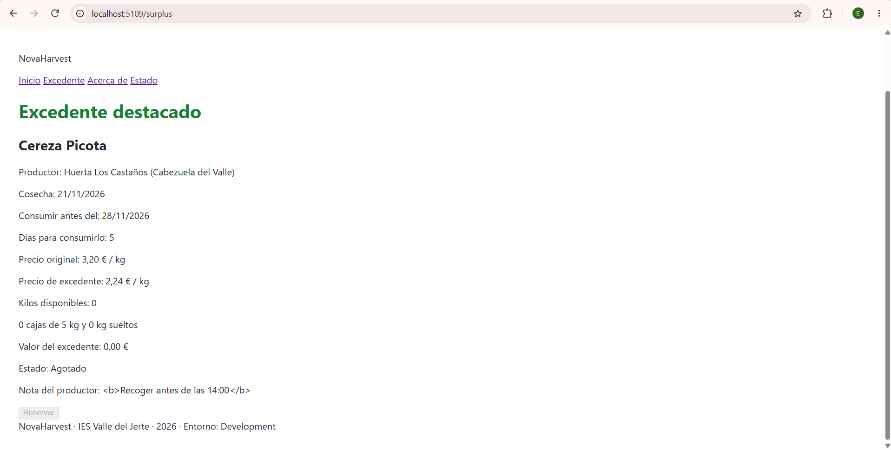
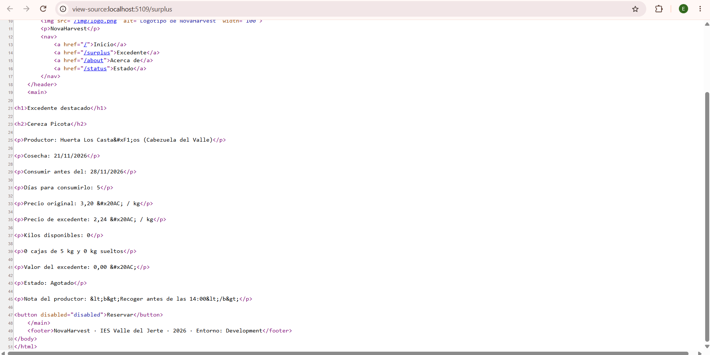

**Escenario D:**

```html
<p class="urgent">Días para consumirlo: 1</p>
<button>Reservar</button>
```

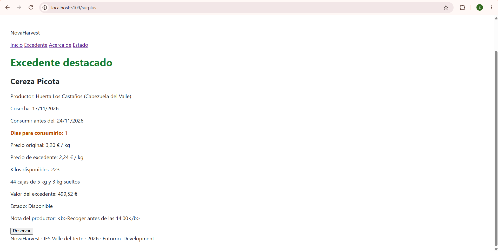
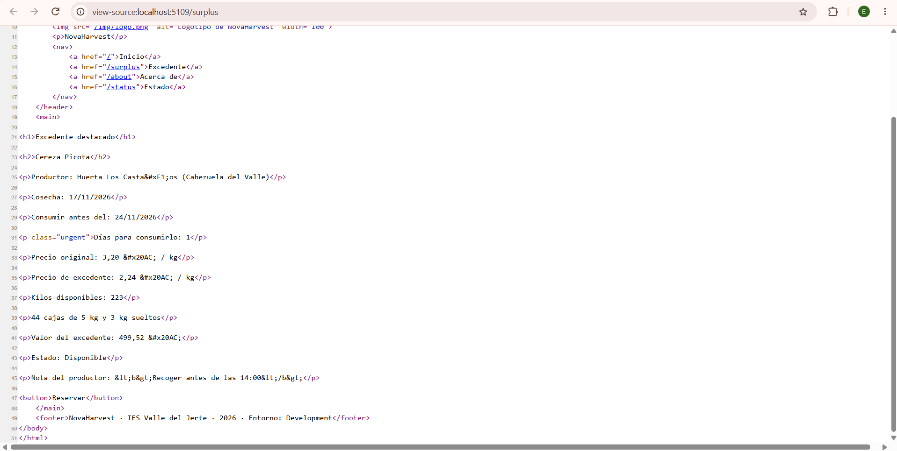

El atributo `class` desaparece cuando la expresión devuelve `null`, y `disabled` desaparece cuando el valor es `false`. En el escenario D aparece `class="urgent"` porque queda un día para consumirlo y todavía hay kilos disponibles. En el escenario C aparece `disabled` porque no quedan kilos.

## 6. Directivas

En mi proyecto utilizo estas directivas y ficheros especiales:

| Directiva o fichero | Comportamiento que cambia |
|---|---|
| `@page` | Convierte el archivo `.cshtml` en una página y le asigna una URL según su ubicación. |
| `@page "/ticket"` | Cambia la URL del justificante a `/ticket`, en lugar de utilizar la ruta de su carpeta. |
| `@model` | Conecta la página con su clase PageModel para poder acceder a sus propiedades. |
| `@using` | Permite utilizar las clases de `NovaHarvest.Web.Models` sin escribir el espacio de nombres completo. |
| `@namespace` | Establece el espacio de nombres de las páginas generadas por Razor para que coincida con el de sus PageModel. |
| `@inject` | Permite recibir objetos de ASP.NET Core. En mi layout utilizo `IWebHostEnvironment Env` para mostrar el entorno. |
| `_ViewStart.cshtml` | Establece `_Layout` como diseño común predeterminado de las páginas. |
| `Layout = null` | Evita que el justificante utilice el layout común, por lo que no muestra la cabecera, el menú ni el pie. |

Al quitar `@namespace` de `_ViewImports.cshtml`, `dotnet build` mostró 6 errores `CS0246`, porque Razor no encontraba las clases `SurplusModel` y `StatusModel`. Esto ocurre porque las páginas generadas dejan de estar en el mismo espacio de nombres que sus PageModel.

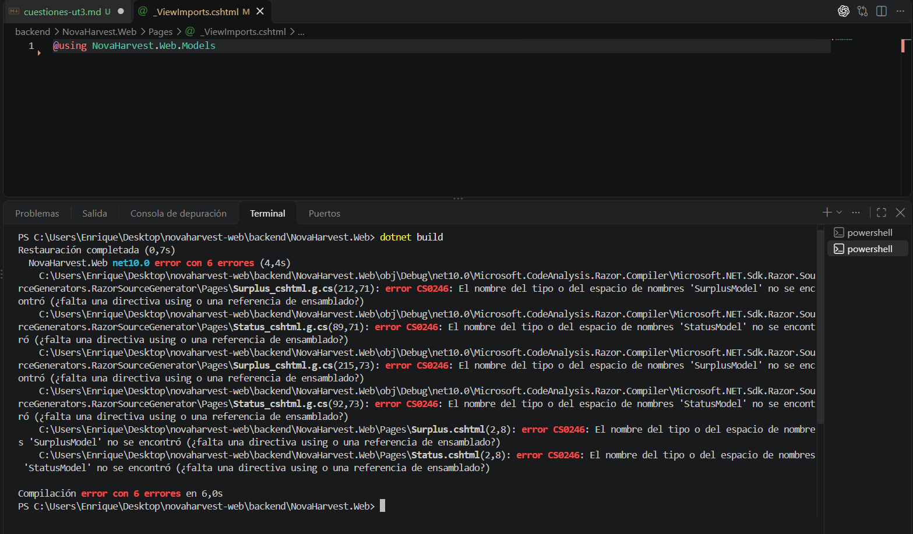

La ruta `/reservations/ticket` devuelve 404 porque en `Ticket.cshtml` he indicado `@page "/ticket"`, sustituyendo la ruta que correspondería por defecto a su carpeta.

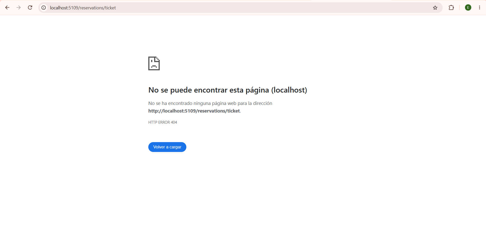

## 7. Tipos y operadores

En mi `SurplusModel` calculo los siguientes datos:

| Dato | Tipo de C# | Operadores o métodos | ¿Por qué ese tipo? |
|---|---|---|---|
| `RemainingKg` | `int` | `-` | Para calcular los kilos enteros que quedan. |
| `FullBoxes` | `int` | `/` | Para obtener el número de cajas completas. |
| `LooseKg` | `int` | `%` | Para calcular los kilos que sobran. |
| `DiscountedPricePerKg` | `decimal` | `*`, `-` | Para calcular el precio rebajado con decimales. |
| `TotalValue` | `decimal` | `*` | Para calcular el valor total del excedente. |
| `ConsumeBefore` | `DateTime` | `AddDays()` | Para guardar la fecha límite de consumo. |
| `DaysToConsume` | `int` | `-`, `.Days` | Para calcular los días que quedan. |
| `Status` | `string` | `==`, `<`, `?:` | Para mostrar un estado en forma de texto. |
| `IsOutOfStock` | `bool` | `==` | Para indicar si no quedan kilos. |
| `IsUrgent` | `bool` | `<=`, `&&`, `>` | Para comprobar si quedan dos días o menos y todavía hay kilos. |

`RemainingKg / BoxKg` da cajas completas porque ambos valores son `int` y C# realiza una división entera, eliminando la parte decimal.

He comprobado qué ocurre al utilizar `decimal`: con una prueba de 12,5 kg y cajas de 5 kg, la división dio `2,5` y el resto también dio `2,5`. Por tanto, el resultado ya no indica directamente las cajas completas.

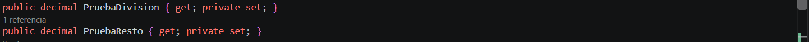

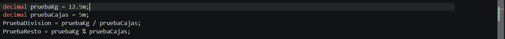

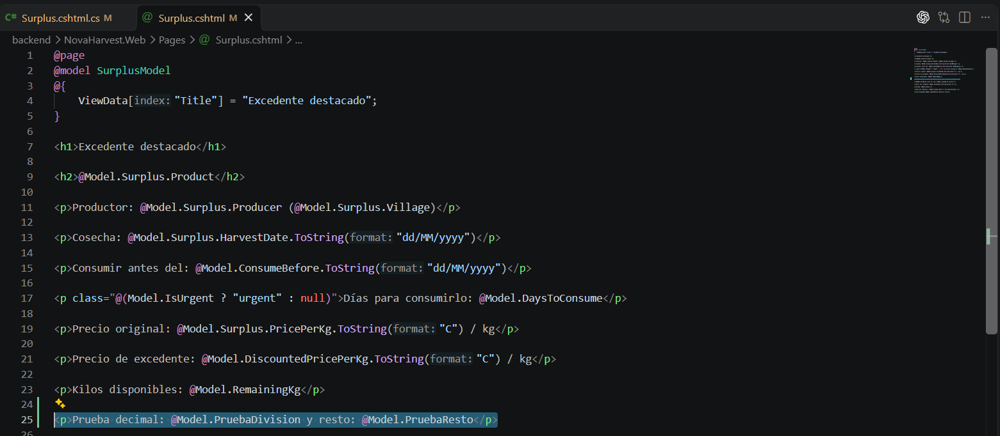

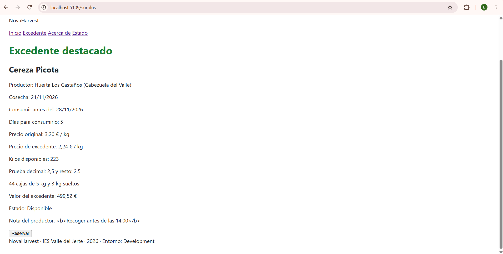

Al mostrar directamente un `bool` con Razor, aparece `True` o `False`. En mi prueba apareció `False`, porque todavía quedaban kilos disponibles.

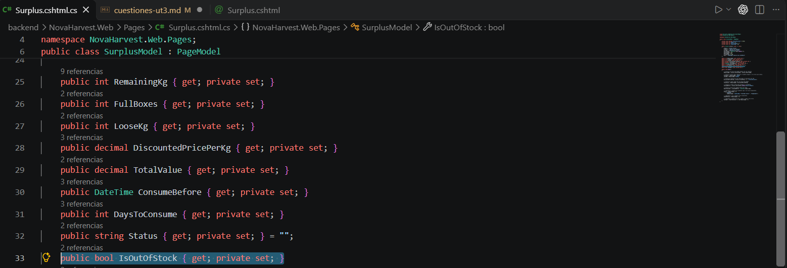

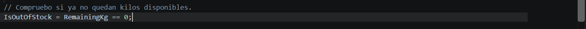

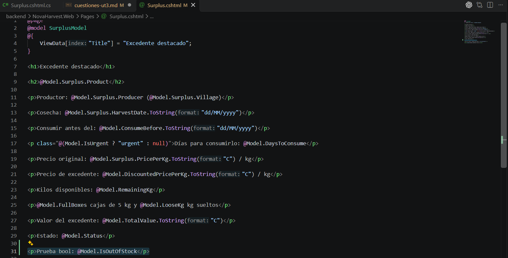

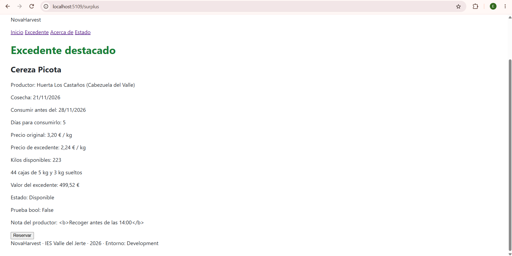

Al mostrar directamente un `null`, Razor no escribe ningún contenido después del texto. Lo he comprobado poniendo la nota del productor a `null`. Por eso utilizo `?? "Sin observaciones"` para mostrar un texto cuando falta la nota.

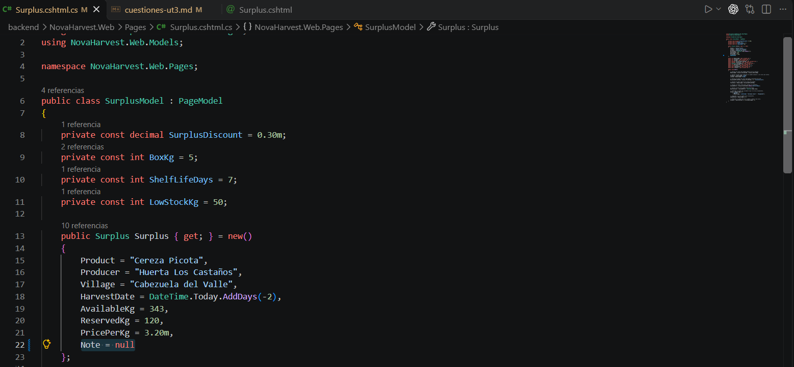

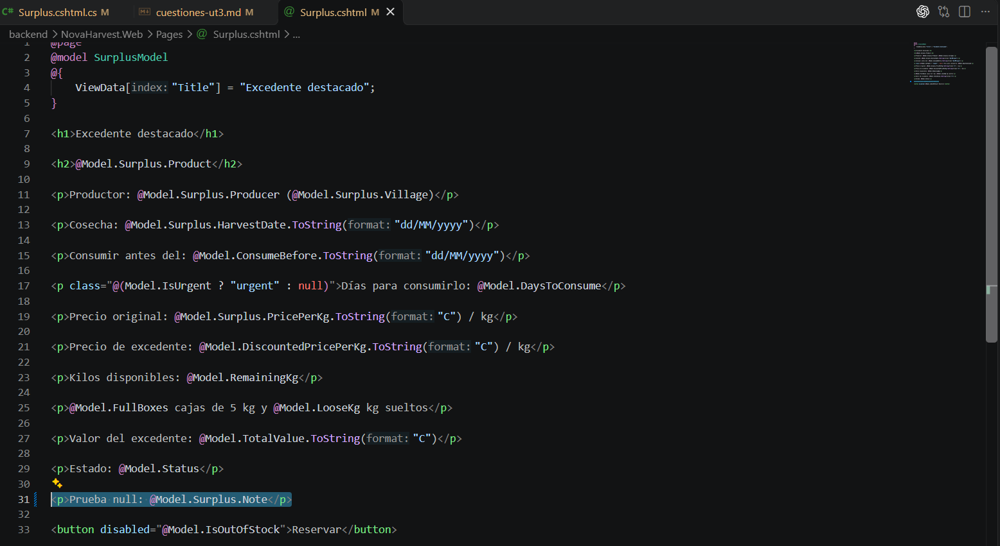

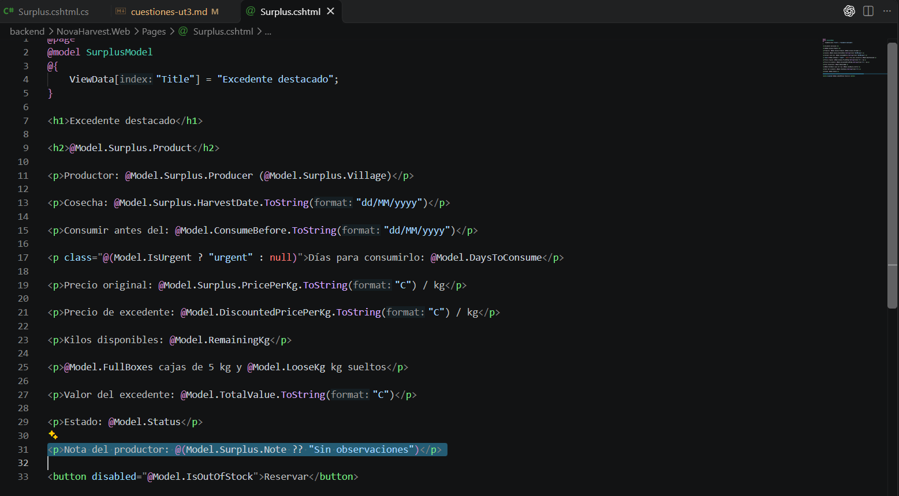

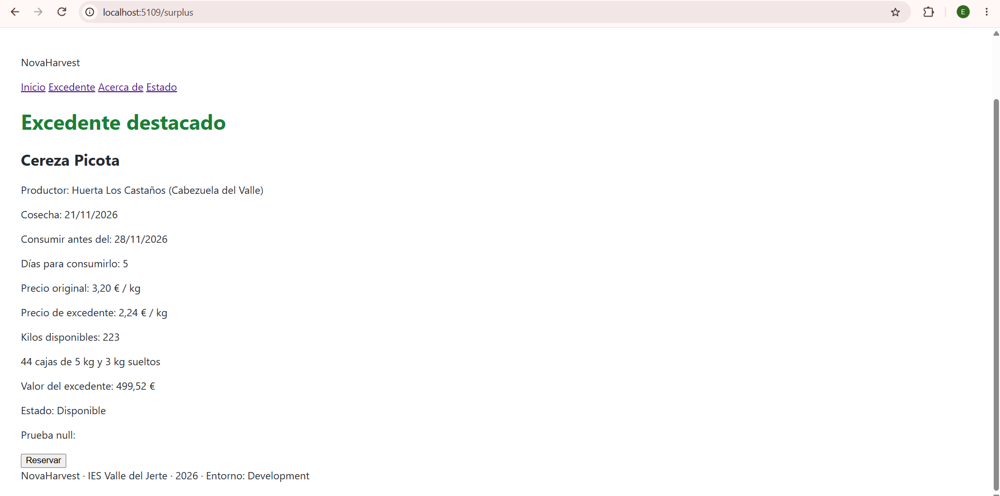

## 8. Cultura

Al quitar `UseRequestLocalization("es-ES")`, en Docker los precios aparecían con el símbolo de moneda genérico `¤` y punto decimal: `¤3.20`, `¤2.24` y `¤499.52`. La fecha también aparecía en inglés: `Monday, 23 November 2026`.

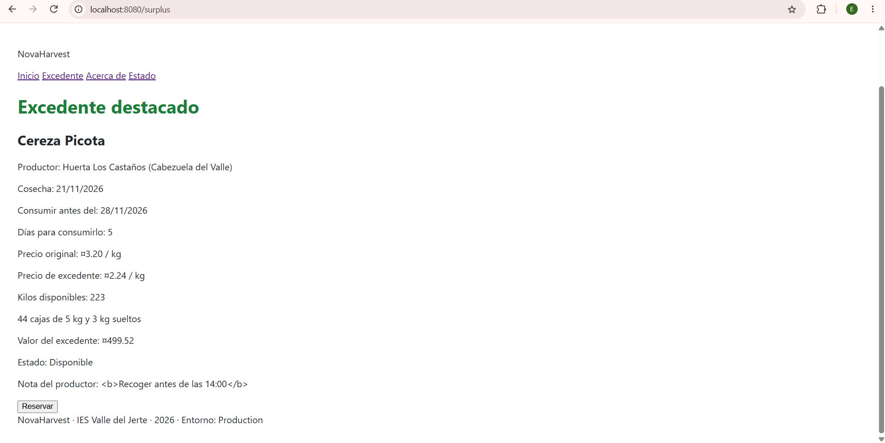
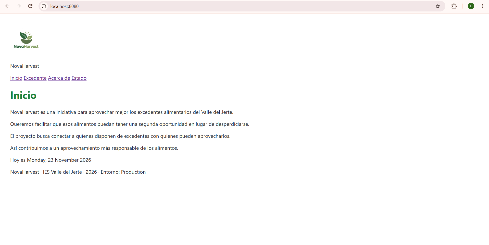

Con `dotnet run`, los precios aparecían en euros y con coma decimal: `3,20 €`, `2,24 €` y `499,52 €`. La fecha aparecía en español: `lunes, 23 de noviembre de 2026`.

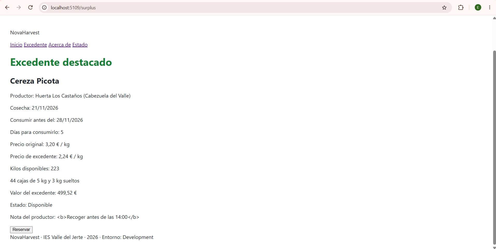
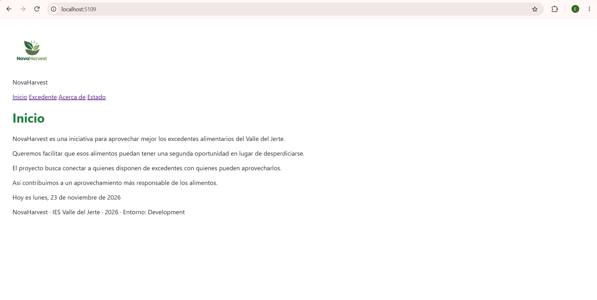

Después volví a añadir `UseRequestLocalization("es-ES")` y reconstruí Docker. Los precios y la fecha aparecieron igual que con `dotnet run`, en español y con euros.


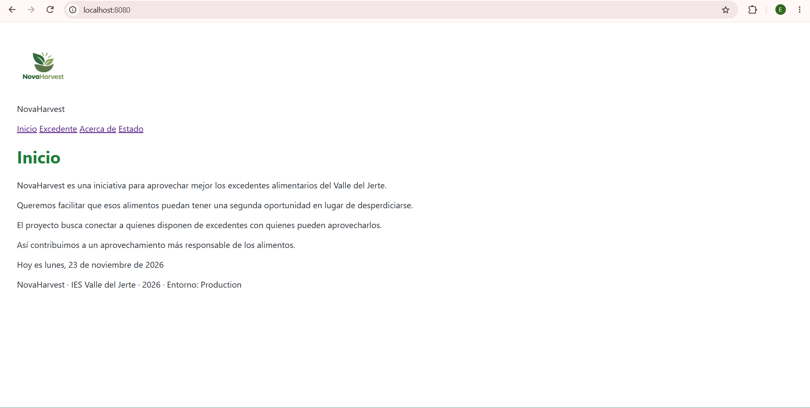

Esta línea establece la cultura española para las peticiones, haciendo que los precios y las fechas se muestren igual independientemente del entorno donde se ejecute la aplicación.

## 9. Ámbito

Primero sustituí temporalmente el contador de `/status` por una variable local, inicializada a 0 e incrementada en cada petición. Al recargar varias veces, siempre aparecía 1 porque la variable vuelve a crearse desde cero en cada petición.

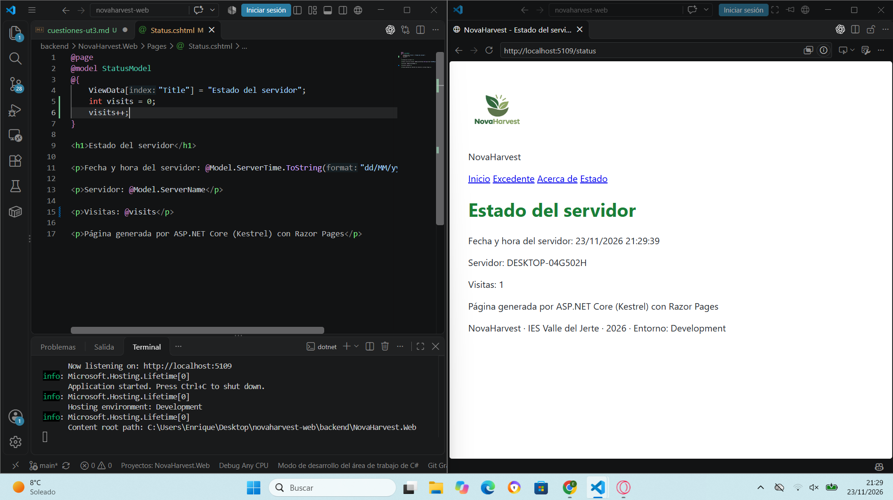

Después volví a utilizar `SiteStats`. El contador fue aumentando con cada visita y se compartía entre navegadores: en Opera llegó a 11 y en Chrome a 10.

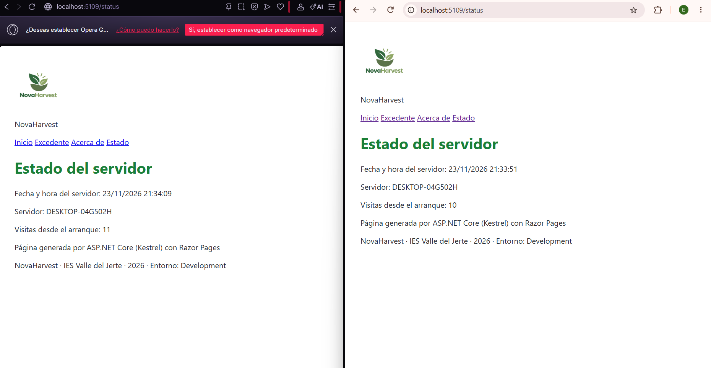

Al ejecutar `docker compose restart backend`, el contador volvió a empezar en 1 porque `SiteStats.Visits` es una variable `static` que se pierde al reiniciar el proceso.

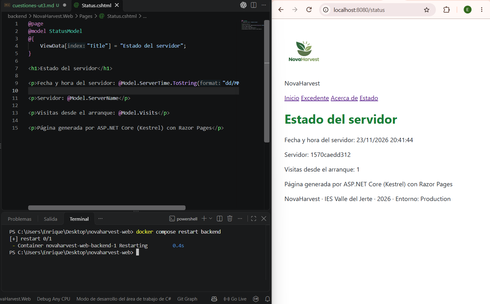

El layout no puede leer una variable local de `Status.cshtml` porque son clases diferentes. Para pasarle el título utilizo `ViewData["Title"]`, que comparten la página y el layout durante la misma petición.

## 10. PageModel

En `SurplusModel` he puesto los datos del excedente, las constantes y todos los cálculos que necesita la página, como los kilos restantes, las cajas completas, los precios y las fechas.

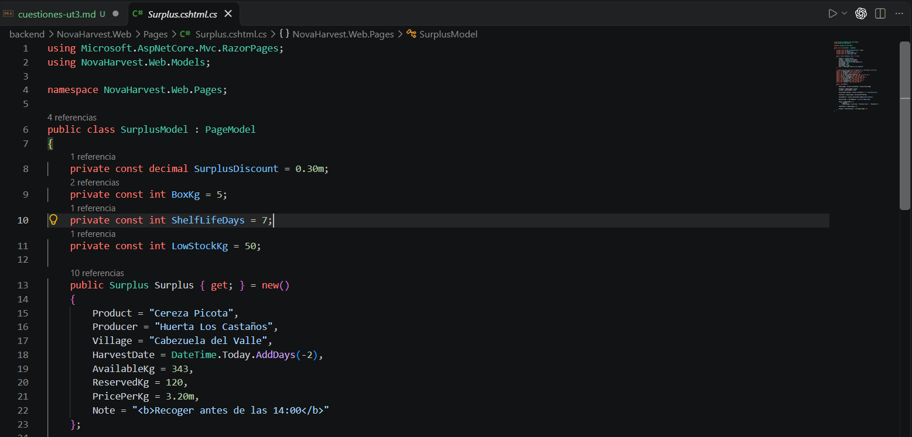

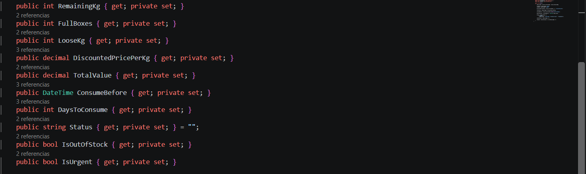

En `Surplus.cshtml` he puesto el HTML y las expresiones `@Model` para mostrar los resultados, porque la página se encarga de presentar la información y el PageModel de calcularla.


Por ejemplo, en `SurplusModel` calculo los kilos restantes restando los kilos reservados a los disponibles (343 - 120 = 223 kg).

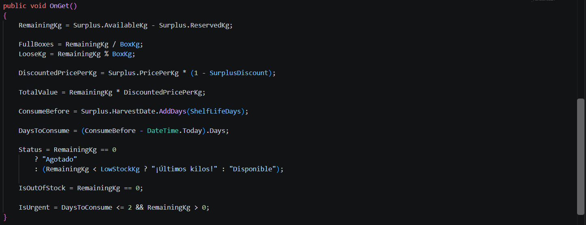

Cada vez que entro en `/surplus`, se crea un objeto `SurplusModel` nuevo. Por eso, si entro tres veces, se crean tres objetos diferentes.
Cada objeto se utiliza para preparar los datos de esa carga de la página y, cuando el servidor termina de responder, deja de utilizarse.
`SiteStats`, en cambio, es una clase `static` compartida por toda la aplicación mientras el backend está funcionando.
Su contador aumenta cada vez que se visita `/status` y es el mismo para todos los navegadores. Cuando se reinicia el backend, vuelve a cero.
Las visitas a `/surplus` no modifican el contador de `SiteStats`.